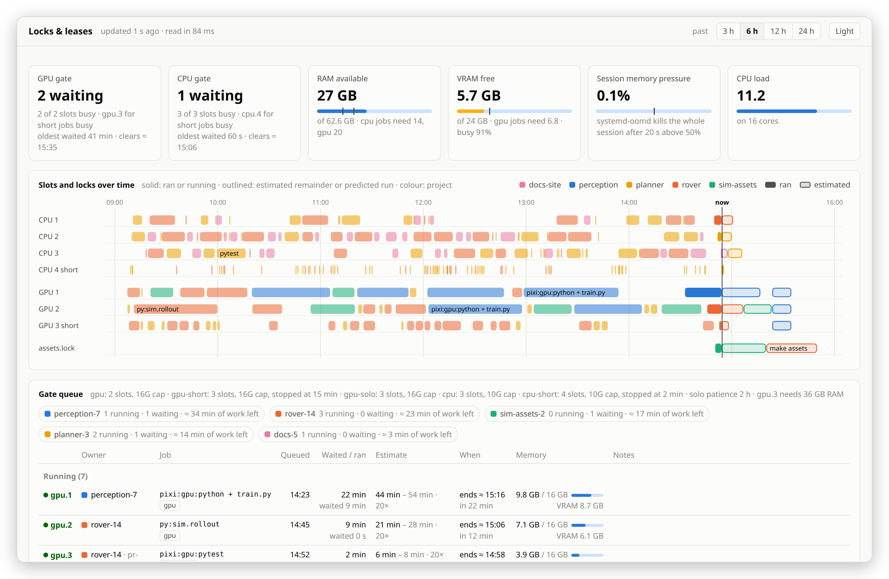
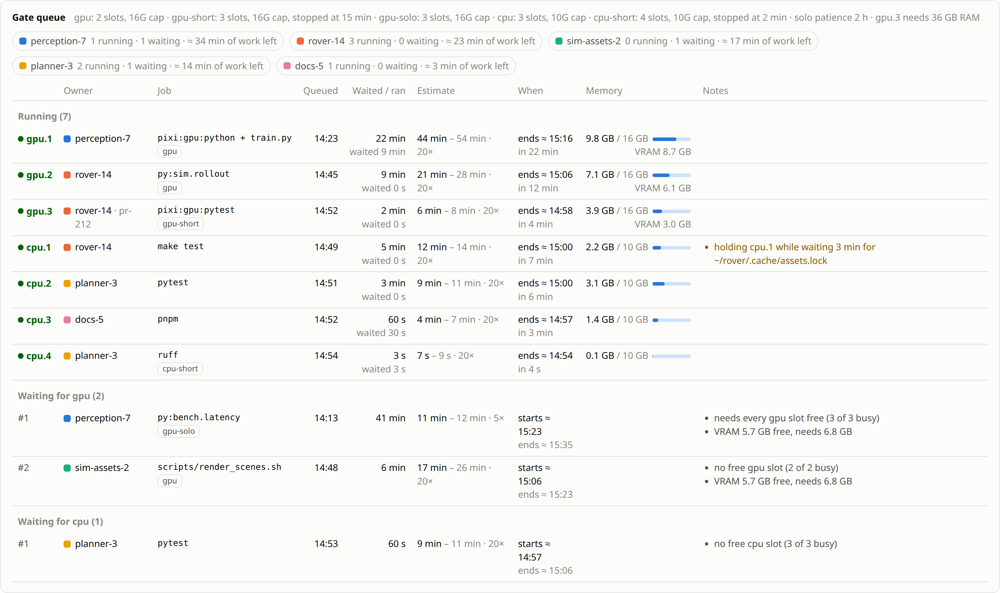
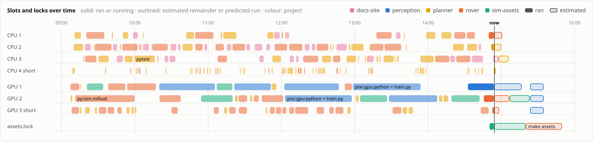
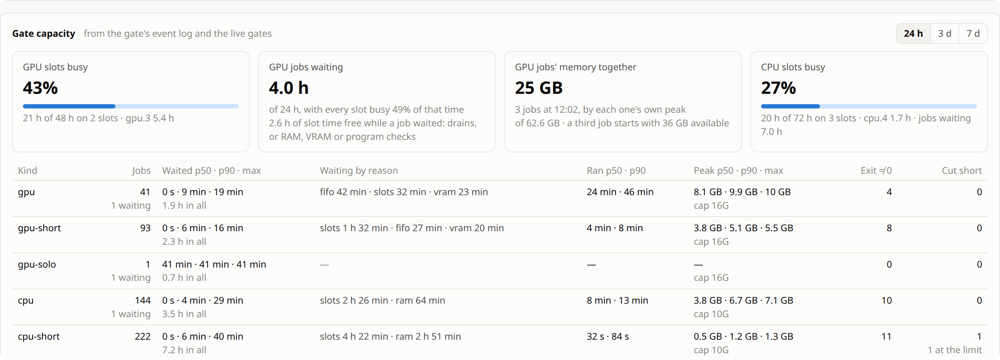
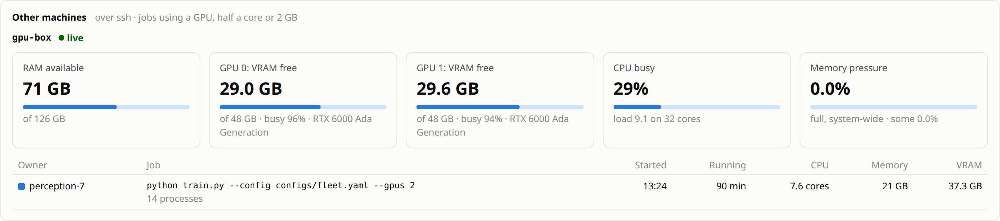
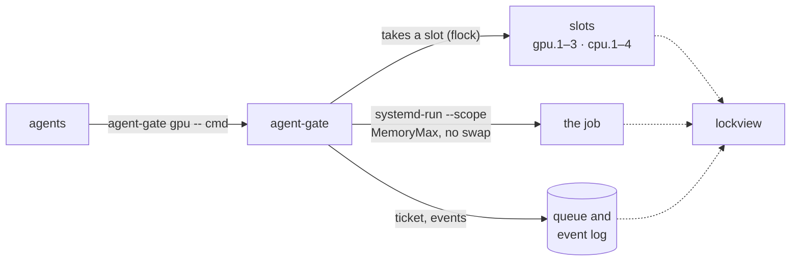

<p align="center">
  
</p>

<h1 align="center">agent-locks</h1>

<p align="center">
  A job queue for AI coding agents that share one Linux machine, and a live view of who is running what.
</p>

<p align="center">
  <a href="https://github.com/mfinean/agent-locks/actions/workflows/test.yml"></a>
  <a href="LICENSE"></a>
  
  
  
  <a href="https://github.com/astral-sh/ruff"></a>
</p>

<picture>
  <source media="(prefers-color-scheme: dark)" srcset="docs/images/window-dark.png">
  
</picture>

Run a few Claude Code sessions on one workstation and sooner or later they all start something heavy
at once: two training runs, a simulation and a full test suite. RAM runs out, systemd-oomd kills your
whole login session, and every agent starts again from nothing.

agent-locks gives them a queue. Agents run heavy commands through **`agent-gate`**, which runs a few
jobs at a time, each in a memory-capped systemd scope, and starts the rest as slots free up.
**`lockview`** shows the queue as it happens: who is running what, who is waiting and why, and when
each job should start and finish.

There is no daemon, nothing runs as root, and both tools use only Python's standard library.

## Features

- **Slots for GPU and CPU work.** By default two GPU jobs and three CPU jobs run at once. Each runs in
  its own systemd scope with a memory cap and no swap, so a runaway job hits its own limit instead of
  taking the session down.
- **Short jobs don't wait behind long ones.** `gpu-short` and `cpu-short` jobs get an extra slot of
  their own, so a linter doesn't wait an hour behind a training run. In return they are stopped at
  their limit: 15 minutes on the GPU, 2 on the CPU.
- **A quiet GPU on request.** A `gpu-solo` job waits until it can have every GPU slot, for benchmarks
  and timing runs. Other GPU jobs may pass it for two hours, and then the GPU drains for it.
- **Fair and safe starts.** GPU jobs start first come, first served, and only once enough RAM and VRAM
  are free.
- **A thrash watchdog.** A job stuck at its memory cap thrashes, and the kernel counts that stall
  against the whole session. The gate kills such a job after three seconds, before systemd-oomd
  kills everything else.
- **It knows whose job it is.** Each job records the Claude Code session that queued it, and its
  project and worktree from git.
- **A live view.** lockview shows why each job waits, how long it should take from past runs, when it
  should start, every slot over time, how busy the gate has been, and jobs on other machines over ssh.

## Install

You need Linux with systemd and cgroup v2, and Python 3.11 or later as `/usr/bin/python3` (Ubuntu
24.04, Debian 12, Fedora 38 or newer). GPU slots use `nvidia-smi`.

```sh
git clone https://github.com/mfinean/agent-locks.git
cd agent-locks
make install    # agent-gate and lockview in ~/.local/bin, and a desktop launcher
mkdir -p ~/.config/agent-locks
cp share/config.example.toml ~/.config/agent-locks/config.toml
```

lockview opens in its own window when the GTK WebKit bindings are installed
(`sudo apt install python3-gi gir1.2-webkit2-4.1` on Ubuntu). Without them, `lockview --browser`
opens it in Chrome or your default browser. `make pin` adds it to the GNOME dock, and
`make uninstall` removes everything again.

## Usage

Put `agent-gate <kind> --` in front of a heavy command:

```console
$ agent-gate gpu -- python train.py --config configs/grasp.yaml
agent-gate: waiting for a gpu slot (0s)
agent-gate: waiting for a gpu slot (300s)
agent-gate: gpu after 412s: python train.py --config configs/grasp.yaml
...
agent-gate: the job's peak memory was 9.8G of 16G
```

| Kind | For | Slots | Memory cap | Stopped after |
|---|---|---|---|---|
| `gpu` | GPU jobs | 2 | 16 GB | |
| `gpu-short` | GPU jobs that finish within 15 minutes | the 2 above, and 1 of its own | 16 GB | 15 min |
| `gpu-solo` | timing runs that need the GPU to themselves | all GPU slots at once | 16 GB | |
| `cpu` | builds, test suites and other heavy CPU work | 3 | 10 GB | |
| `cpu-short` | linters, one test file, quick scripts | the 3 above, and 1 of its own | 10 GB | 2 min |

These are the defaults, and `config.toml` sets them for your machine. The gate's exit code is the
job's own. A short job stopped at its limit exits with 143, or 137 if it ignored SIGTERM, and a job
the thrash watchdog kills exits with 137.

`agent-gate status` lists the queue:

```console
$ agent-gate status
pid kind state needs-idle-gpu age command
48359 gpu-solo waiting yes 41:07 python -m bench.latency --runs 50
48396 gpu waiting no 06:12 bash scripts/render_scenes.sh warehouse
48211 gpu running no 31:02 pixi run -e gpu python train.py --config configs/grasp.yaml
48248 gpu running no 09:15 python -m sim.rollout --scenes 64 --headless
programs running: 0; RAM available: 27 GB; GPU free: 5814 MiB
```

## Tell your agents

The gate only helps if agents use it. Add something like this to your `CLAUDE.md` or `AGENTS.md`:

```markdown
## Shared machine: agent-gate

Run any command that uses the GPU or loads the CPU for more than a few seconds through
`agent-gate <kind> -- <command>`. `agent-gate status` lists the queue.

- `gpu-short` for a GPU job that ends within 15 minutes, `gpu` for a longer one, and `gpu-solo`
  for timing measurements that need a quiet GPU.
- `cpu-short` for a CPU job that ends within 2 minutes (a linter, one test file), and `cpu` for
  longer builds and test suites.
- Light commands such as git, grep and ls run directly.
- A queued job may wait a while, so run long jobs in the background.
- A short job is stopped at its limit (exit 143 or 137). Rerun it as `gpu` or `cpu`.
- Never cancel or requeue another session's job.
```

## Configuration

`~/.config/agent-locks/config.toml` holds your machine's numbers. The
[example](share/config.example.toml) explains each one:

```toml
[gpu]
slots = 2                # gpu jobs that run at once
short_slots = 1          # extra slots that only gpu-short jobs may take
memory_max_gb = 16       # each job's memory cap
ram_needed_gb = 20       # RAM that must be available before a GPU job starts
vram_needed_mb = 7000    # free VRAM a GPU job needs to start
short_limit_min = 15     # gpu-short jobs are stopped after this long
solo_patience_min = 120  # once a gpu-solo job has waited this long, the GPU drains for it
programs = []            # programs that must run through the gate, e.g. ["*/envs/sim/bin/python*"]

[cpu]
slots = 3
short_slots = 1
memory_max_gb = 10
ram_needed_gb = 14
short_limit_min = 2

[remote]
hosts = []               # other machines to watch over ssh, by ssh alias
```

A waiting gate rereads the file every time it looks, so a change applies to jobs already in the
queue. A machine without a GPU leaves out `[gpu]`. One GPU job that needs more free VRAM than usual
can ask for it with `AGENT_GATE_VRAM_MB`.

## lockview

The queue: each job's owner, its estimated run time from past runs of the same command, when it
should start and end, its memory, and every reason it still waits.

<picture>
  <source media="(prefers-color-scheme: dark)" srcset="docs/images/queue-dark.png">
  
</picture>

Every slot over the past hours, coloured by project. Outlined bars are what is still to come.

<picture>
  <source media="(prefers-color-scheme: dark)" srcset="docs/images/timeline-dark.png">
  
</picture>

How busy the slots were over the past day, three days or week, how long each kind of job waited
and why, and how much memory GPU jobs used together.

<picture>
  <source media="(prefers-color-scheme: dark)" srcset="docs/images/capacity-dark.png">
  
</picture>

Other machines your agents use over ssh. List their aliases under `[remote]`, and lockview runs a
small probe there over the ssh connection, with nothing to install.

<picture>
  <source media="(prefers-color-scheme: dark)" srcset="docs/images/machines-dark.png">
  
</picture>

It also shows other `flock` locks: any `.lock` file under your home that a process holds, and any
lock a process waits for. lockview only reads: it never takes a slot, edits the queue or signals a
process. `lockview --serve` serves the page without
opening a window.

## How it works



Each `agent-gate` call is a small process. It writes a ticket into a queue directory, waits until
the rules let it take a slot, then runs the job with `systemd-run --user --scope` under a memory cap
and exits with the job's exit code. The slots are `flock` locks that the job inherits, so a job keeps
its slot even if its gate is killed. Every gate appends what happens to its job to an event log,
which lockview reads for history and estimates.

The rules live in one module, `lockview/policy.py`, which the gate and lockview share, so the
reasons lockview shows are the gate's own.

[docs/how-it-works.md](docs/how-it-works.md) has the details: the rules in order, the event log's
format, how lockview finds a job's owner and estimates its run time, and what it can't see.

### Why not a cluster scheduler?

Slurm and similar schedulers are built for clusters: a daemon, site-wide configuration, accounts.
agent-gate is one command on one machine. A job keeps its own output, exit code and pid, so an agent
uses it like any other command.

## Development

```sh
make test                    # pytest and shellcheck
make lint                    # ruff
python3 docs/screenshots.py  # redraw the screenshots above from a made-up machine
```

The tests stub out `systemd-run` and `nvidia-smi`, so they need no GPU and start no real jobs.

## Licence

[MIT](LICENSE)
